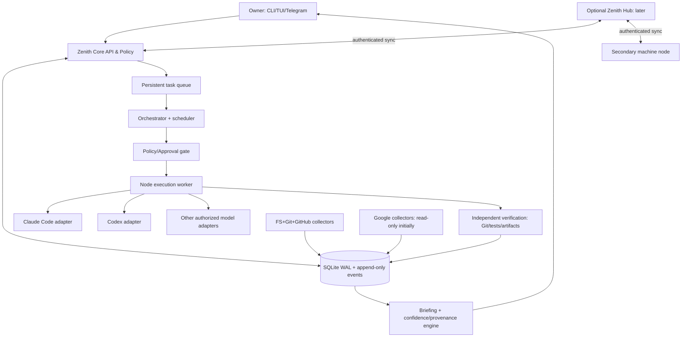

# 02 — System Architecture / Sistem Mimarisi

**Reference architecture:** modular monolith + separate optional node/hub runtime; incremental extraction later.

## 1. Containers and data flow


### Process separation
1. `zenith-core`: registry, events, task state, authorization, scheduling, briefing API.
2. `zenith-node`: runs on each host with narrowly scoped project allowlists, reads Git/fs, starts bounded agents.
3. `zenith-hub`: **future** always-on private coordination and sync endpoint (local services do not require it).
4. `zenith-ui`: terminal CLI initially; Textual TUI next; mobile via Telegram bot later.

Initially `core` and `node` can run in one Python process: do not prematurely use microservices, Redis, Kafka or Kubernetes. Split modules, not deployments.

## 1b. Responsibility split (Sprint 2, REQ-001/REQ-003)
| Component | Owns | Implementation today |
|---|---|---|
| **Zenith Core** | project memory, task state, authorization, evidence, scheduling, budgets, continuity | `kernel`, `policy`, `migrations`, `brief` — generic, no repository assumption |
| **Engineering Director** (port) | architectural reasoning, decomposition, prompt engineering, review, next steps | `agents.base.DirectorAdapter`; `FakeDirector` only; Codex later |
| **Implementation Agent** (port) | executes one stamped prompt inside its worktree | `agents.base.ImplementerAdapter`; `FakeImplementer` only; Claude Code later |
| **Independent Verifier** | deterministic evidence: exit codes, diff scope, revision, artifacts, freshness | `verify.py` (core trust base, never a plugin) |
| **Machine Runtime** | isolated execution, leases, timeouts, resource limits | `sandbox.py` (bubblewrap, fail closed), `orchestration.py` worker |
| **Extensions** | discovery/enablement of adapters and modules | `extensions.py` (entry points; ADR-006) |
| **Provider clients** (live, gated) | Claude Code / Codex CLIs inside the provider sandbox profile | `agents/providers.py`, `netproxy.py`, `sandbox_forwarder.py` (ADR-007) |
| **Identity** | stable ids, display names, roles, attribution | `identity.py` (REQ-004) |

Trusted control plane vs isolated runtime (ADR-007): Zenith core, verifier, orchestrator and the allowlist proxy are the control plane on the host; provider CLIs run as sandboxed clients with their own credential and provider-only egress; repository code runs in a second, credential-free sandbox. Nothing in the control plane is reachable from either sandbox except the proxy socket.

Hexagonal view: the core exposes an application API (`Store`, `Orchestrator`); ports are the adapter Protocols and the sandbox runner; adapters are the fakes today and provider CLIs/SDKs later; the CLI is a driving adapter. Engineering-specific modules (`contracts`, `orchestration`, `verify`, `worktree`, `sandbox`, `demo`) form a first-party feature module and will move under `zenith.engineering` (behaviour-neutral).

## 1c. Product and identity model: Misa on Zenith (REQ-004/005/008)
Zenith is the platform (memory, orchestration, permissions, extension runtime); **Misa** is the personal intelligence that runs on it. Misa's identity, context, history and commitments live in Zenith's store and survive any change of provider; the Engineering Director is one Misa capability among several (personal, research, creative — REQ-005/006/007).

**Domain boundaries** (each a module with its own tables and events; shared only through the core API):

| Domain | Owns | Today |
|---|---|---|
| Projects & sources | project memory, scans, evidence | implemented |
| Tasks & commitments | tasks, dependencies, deadlines; future `commitment` entity | tasks implemented |
| Conversations | assistant turns, continuity, retrieval cursors | planned (S3/S4) |
| Execution history | runs, artifacts, decisions, verification | implemented |
| Research | sources, verified findings, reports (REQ-006) | deferred |
| Creative ideas | ideas, provenance, novelty assessments (REQ-007) | deferred |
| Notifications | outbox (event-driven, deduplicated, quiet hours, channel authorization, meaningful content only: progress/blockers, pending decisions, verified milestones, research completion, academic deadlines, stale context, follow-up questions; no sensitive content on unauthorized channels) | deferred (S4) |
| Persona & communication policy | persona configuration, templates, style separation (REQ-010) | planned (S3/S4) |

**Specialist roles (REQ-009).** Roles are logical capabilities filled by adapters through the extension registry; a reasoning role may propose a team, but a deterministic *role planner/enforcer* decides which roles a task is allowed and enforces authorization, budgets, concurrency and execution boundaries (an engineering task: director + implementer + verifier; a research task: lead → discovery → analysis → methodology judge → evidence judge → synthesis). Roles exchange only versioned contracts and persisted artifacts; the verifier and the two judges are schema-driven and impartial. Research reuses the same orchestration (runs, leases, budgets), approvals, artifacts, evidence ledger and routing as engineering — no second agent framework; MCP stays an optional interoperability boundary, not the orchestration core.

**Style separation (REQ-010).** Deterministic Turkish templates (policy: humour intensity, verbosity, frequency, tone) serve notifications and fallbacks; interactive Misa conversation will be model-generated, grounded in stored evidence and governed by the same policy; reports, judges and verification output bypass the persona entirely.

**Versioned memory and context interfaces.** Anything handed to a model is a versioned contract (`zenith.director.v1` today; `zenith.context.v*`/`zenith.memory.v*` for future capabilities); artifacts are immutable with digests; retrieval is deterministic (metadata/keyword first). **Proactivity** is driven by deterministic schedulers and observers that escalate to a reasoning model only when analysis is needed, always under notification policy, authorization, quiet hours and explicit user controls; no always-running LLM process.

## 2. Major logical modules
- **Registry:** projects, paths, repositories, external records, workspaces, roles.
- **Evidence ledger:** provenance-stamped snapshots, commit/test links, human claims, document references.
- **Task engine:** explicit lifecycle, dependencies, due dates, risk, approval and idempotency.
- **Planner router:** deterministic pre-checks → authorized model provider for nontrivial reasoning.
- **Agent orchestration:** director plan → implement → verify → director review → finalize; execution runs with leases, idempotency keys, cancellation, timeouts, bounded retries, crash recovery to `RECONCILE_REQUIRED`; worktrees; approval consumption.
- **Verification:** independent test result capture and diff checking; don't trust agent self-report.
- **Memory/briefing:** summarization on demand; confidence and last-seen timestamps; targeted questions.
- **Collector adapters:** Git, FS, GitHub, Gmail, Calendar; source data as untrusted input.
- **Notification outbox:** durable, deduped messages; Telegram later; no message direct from LLM.
- **Machine coordinator:** heartbeats, leases, stale machine state; remote hub later.

## 3. Execution / authority flow
```mermaid
sequenceDiagram
  actor Owner
  participant Core
  participant Policy
  participant Codex
  participant Claude
  participant Verify
  Owner->>Core: Goal / approval envelope
  Core->>Policy: Validate scope + credentials + budget
  Policy-->>Core: Authorized or Awaiting Approval
  Core->>Codex: Plan (structured; read-only)
  Codex-->>Core: Architecture + acceptance plan
  Core->>Policy: Re-check planned actions
  Core->>Claude: Implement in dedicated worktree
  Claude-->>Core: Result, artifacts, claimed status
  Core->>Verify: Execute allowed tests, inspect diff
  Verify-->>Core: Independent evidence
  alt Pass
     Core-->>Owner: Ready for review, no auto-push
  else Fixable within budget
     Core->>Codex: Review failed evidence (bounded retry)
  else Unsafe/unclear
     Core-->>Owner: Needs approval or blocked
  end
```

## 4. Execution isolation
- Every write-capable job gets its own Git worktree and scoped process cwd.
- Single concurrent writer per repository branch; parallel read-only planners allowed.
- No untrusted shell interpolation; fixed argument vectors and command allowlist in executor.
- Agent CLI subprocess stdout/stderr are logged with truncation/redaction, not trusted as executable instructions.
- A lost worker lease moves task to `RECONCILE_REQUIRED` (future extension), **not** blindly re-run.
- `tmux` attaches to log/PTY only where supported and authorized; CLI processes remain independent from compositor.

## 5. Device / sync design
- Node ID distinct from host name; XDG state + local database.
- Node advertises capabilities (available CLI tools, runtime, GPU), approved roots and last heartbeat.
- Source observations include `(node_id, path_id, observed_at, content_signature)`; staleness visible.
- Hub sync uses authenticated outbound channels, scoped node tokens, replay/idempotency handling; no public unauthenticated shell endpoints.
- Offline conflicts append provenance events and require reconciliation for destructive conflicts. Never use last-write-wins blindly for user decisions.
- Time values UTC internally; present in Europe/Istanbul or user configured timezone.

## 6. LLM routing (REQ-008)
- Local deterministic logic: path Git diff, due dates, state machines, policy.
- Strong LLM: scoped architecture reasoning, technical analysis, complex digest generation.
- Provider selection by task type, required reasoning quality, tool/execution capabilities, privacy restrictions (data classification, cloud consent), provider availability, monetary cost and user preference (REQ-008); the router is deterministic code over adapter manifests, not a model.
- Cloud-disabled mode queues remote-model tasks while filesystem/registry work continues.
- Claude Code CLI = optional personal local tool integration subject to provider terms; API-backed SDK = programmatic service integration with authorized credentials. Never assume personal subscription can be wrapped into a generic API service.

## 7. Incremental releases
- **S0:** starter CLI + registry and event log (included).
- **S1:** durable task/approval/state schema + evidence and scanner.
- **S2:** **done with fake adapters:** director protocol artifacts, durable runs, approval consumption, bubblewrap-isolated verification, mock POC. Live adapters are S2-09 (gated).
- **S3:** tmux/Hyprland observer UI with version probing; agent processes must survive UI closure.
- **S4:** proactive check-in, digest, scheduler and Telegram.
- **S5:** OAuth integrations, multi-node sync and optional private Hub.

See ADRs for tradeoffs and `07_ROADMAP_TEST_PLAN.md` for exit gates.
