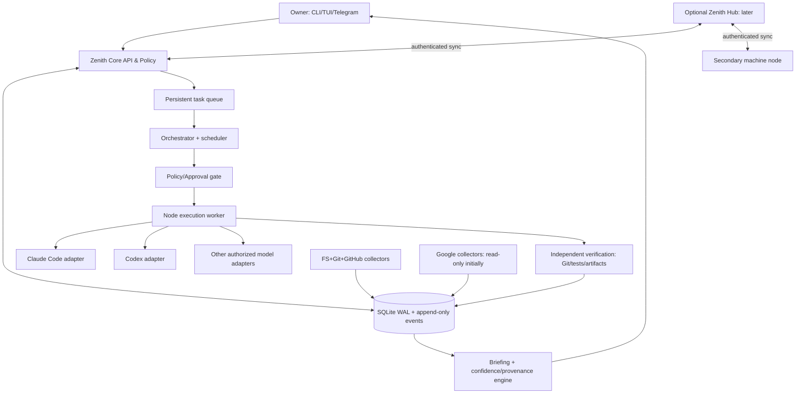

# 02 — System Architecture / Sistem Mimarisi

**Reference architecture:** modular monolith + separate optional node/hub runtime; incremental extraction later.

## 1. Containers and data flow


### Process separation
1. `zenith-core`: registry, events, task state, authorization, scheduling, briefing API.
2. `zenith-node`: runs on each host with narrowly scoped project allowlists, reads Git/fs, starts bounded agents.
3. `zenith-hub`: **future** always-on private coordination and sync endpoint (local services do not require it).
4. `zenith-ui`: terminal CLI initially; Textual TUI next; mobile via Telegram bot later.

Initially `core` and `node` can run in one Python process: do not prematurely use microservices, Redis, Kafka or Kubernetes. Split modules, not deployments.

## 2. Major logical modules
- **Registry:** projects, paths, repositories, external records, workspaces, roles.
- **Evidence ledger:** provenance-stamped snapshots, commit/test links, human claims, document references.
- **Task engine:** explicit lifecycle, dependencies, due dates, risk, approval and idempotency.
- **Planner router:** deterministic pre-checks → authorized model provider for nontrivial reasoning.
- **Agent orchestration:** planner→implementer→reviewer; worktrees; bounded retries; session mapping.
- **Verification:** independent test result capture and diff checking; don't trust agent self-report.
- **Memory/briefing:** summarization on demand; confidence and last-seen timestamps; targeted questions.
- **Collector adapters:** Git, FS, GitHub, Gmail, Calendar; source data as untrusted input.
- **Notification outbox:** durable, deduped messages; Telegram later; no message direct from LLM.
- **Machine coordinator:** heartbeats, leases, stale machine state; remote hub later.

## 3. Execution / authority flow
```mermaid
sequenceDiagram
  actor Owner
  participant Core
  participant Policy
  participant Codex
  participant Claude
  participant Verify
  Owner->>Core: Goal / approval envelope
  Core->>Policy: Validate scope + credentials + budget
  Policy-->>Core: Authorized or Awaiting Approval
  Core->>Codex: Plan (structured; read-only)
  Codex-->>Core: Architecture + acceptance plan
  Core->>Policy: Re-check planned actions
  Core->>Claude: Implement in dedicated worktree
  Claude-->>Core: Result, artifacts, claimed status
  Core->>Verify: Execute allowed tests, inspect diff
  Verify-->>Core: Independent evidence
  alt Pass
     Core-->>Owner: Ready for review, no auto-push
  else Fixable within budget
     Core->>Codex: Review failed evidence (bounded retry)
  else Unsafe/unclear
     Core-->>Owner: Needs approval or blocked
  end
```

## 4. Execution isolation
- Every write-capable job gets its own Git worktree and scoped process cwd.
- Single concurrent writer per repository branch; parallel read-only planners allowed.
- No untrusted shell interpolation; fixed argument vectors and command allowlist in executor.
- Agent CLI subprocess stdout/stderr are logged with truncation/redaction, not trusted as executable instructions.
- A lost worker lease moves task to `RECONCILE_REQUIRED` (future extension), **not** blindly re-run.
- `tmux` attaches to log/PTY only where supported and authorized; CLI processes remain independent from compositor.

## 5. Device / sync design
- Node ID distinct from host name; XDG state + local database.
- Node advertises capabilities (available CLI tools, runtime, GPU), approved roots and last heartbeat.
- Source observations include `(node_id, path_id, observed_at, content_signature)`; staleness visible.
- Hub sync uses authenticated outbound channels, scoped node tokens, replay/idempotency handling; no public unauthenticated shell endpoints.
- Offline conflicts append provenance events and require reconciliation for destructive conflicts. Never use last-write-wins blindly for user decisions.
- Time values UTC internally; present in Europe/Istanbul or user configured timezone.

## 6. LLM routing
- Local deterministic logic: path Git diff, due dates, state machines, policy.
- Strong LLM: scoped architecture reasoning, technical analysis, complex digest generation.
- Provider selection by capability, credentials, cost, privacy/data locality, task risk, latency.
- Cloud-disabled mode queues remote-model tasks while filesystem/registry work continues.
- Claude Code CLI = optional personal local tool integration subject to provider terms; API-backed SDK = programmatic service integration with authorized credentials. Never assume personal subscription can be wrapped into a generic API service.

## 7. Incremental releases
- **S0:** starter CLI + registry and event log (included).
- **S1:** durable task/approval/state schema + evidence and scanner.
- **S2:** authorized agent adapter, isolated worktree, mock and genuine bounded POC.
- **S3:** tmux/Hyprland observer UI with version probing; agent processes must survive UI closure.
- **S4:** proactive check-in, digest, scheduler and Telegram.
- **S5:** OAuth integrations, multi-node sync and optional private Hub.

See ADRs for tradeoffs and `07_ROADMAP_TEST_PLAN.md` for exit gates.
