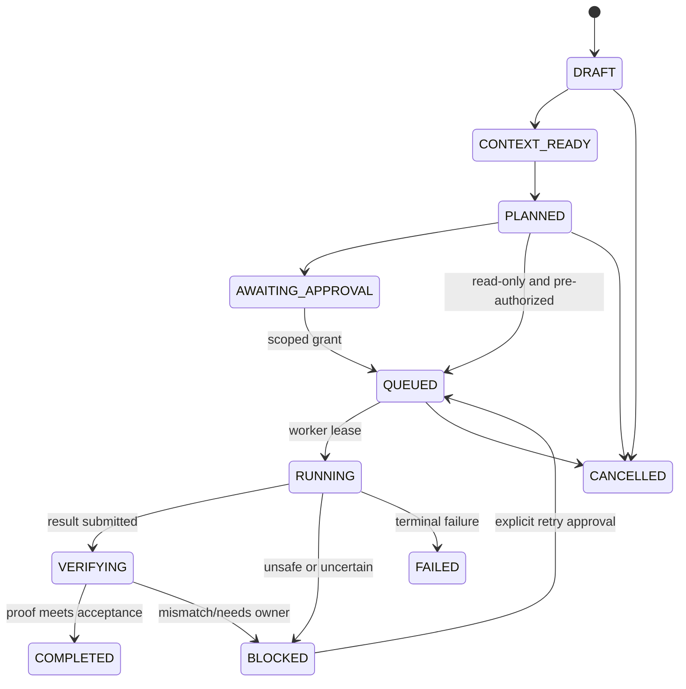

# 04 — Agent Collaboration Protocol (ACP)

This is **Zenith's internal task contract**, not a claim of standard protocol compatibility. MCP is an exposure surface for tools; ACP governs durable tasks, approvals and evidence.

## 1. Roles
- **Zenith Orchestrator:** owns task state, authorized context, role assignment, budget, deadlines, worktree lease.
- **Architect/Planner** (Codex default, replaceable): produces bounded plan with measurable acceptance criteria; no write permissions by default.
- **Implementer** (Claude Code default, replaceable): modifies an isolated authorized worktree, runs approved tests, produces structured report.
- **Reviewer** (Codex or another model, replaceable): examines diffs and failed evidence; advisory, not final proof.
- **Verifier** (deterministic Zenith worker): checks artifact hashes, diff scope, tests, process exit codes. Independent of a model.

## 2. Task lifecycle


**Guard rule:** state transitions are made by Zenith code, not by any LLM text. A worktree write always needs policy allowance and valid approval scope; even when the task state is `QUEUED`.

## 3. Machine-readable task envelope (illustrative)
```json
{
  "protocol_version": "zenith.acp.v1",
  "task_id": "ZEN-0042",
  "project_id": "stabilimentum",
  "idempotency_key": "sha256-scoped-hash",
  "objective": "Review and improve the existing module architecture",
  "task_type": "engineering",
  "input_refs": ["git:HEAD", "doc:architecture-v1"],
  "constraints": ["No network", "No new features", "Keep tests green"],
  "acceptance": [{"kind": "command", "name": "unit-tests", "expected": "exit-code-0"}],
  "execution": {
    "planner": "codex",
    "implementer": "claude-code",
    "reviewer": "codex",
    "max_review_cycles": 2,
    "max_attempts": 3,
    "max_wall_seconds": 1800,
    "max_budget_usd": 5.0
  },
  "authorization": {
    "risk": "L2",
    "allowed_roots": ["/approved/project/worktree"],
    "can_push": false,
    "can_deploy": false,
    "can_send_email": false
  }
}
```

Do not let the model edit the authorization envelope. Cryptographically hash canonicalized scope fields before approval; if plan changes, reauthorize.

## 4. Response envelope (from any agent)
```json
{
  "protocol_version": "zenith.acp.v1",
  "task_id": "ZEN-0042",
  "role": "implementer",
  "claimed_status": "ready_for_verification",
  "summary": "Adjusted dependency boundaries and added tests",
  "files_changed": ["src/example.py", "tests/test_example.py"],
  "tests_claimed": [{"command_id": "unit-tests", "claimed_pass": true}],
  "blocking_questions": [],
  "artifacts": ["artifact://runs/ZEN-0042/report.json"]
}
```

`claimed_status` is *not* a trusted `task.state`. Verification independently runs the checks and reads output.

## 5. Retry and non-repetition policy
- Max 3 attempts, 2 reviewer loops by default; strict budget and wall-clock deadline.
- Retry only on diagnostic evidence and changed repair plan; repeated identical failures produce `BLOCKED`.
- Pause on approval timeout, credentials/auth errors, unexpected file changes or tool version mismatch.
- Same `idempotency_key` cannot schedule duplicate execution on the same scope.

## 6. CLI adapter implementation rules
- Use documented noninteractive modes. Claude: `claude -p --output-format json`; Codex: `codex exec --json` (JSONL events).
- Do not confuse `codex exec --json` JSONL with a single JSON document.
- Invoke commands with argument arrays, `shell=False`, explicit cwd, subprocess timeouts and controlled environment.
- Do not rely on subscription credentials for a third-party hosted API wrapper. Require supported authentication and settings.
- Session/stream adapters implement `start`, `poll/stream`, `cancel`, `collect_result`; `resume` only after checking current provider behavior.
- Store provider session IDs and use adapters to reconnect, never rely on tmux text scraping as ground truth.

## 7. Independent verification
- Validate worktree branch, allowed diff paths, `git diff --check`, expected output files, test commands with captured exit statuses.
- Reviewers provide risk findings. No successful verification if required deterministic tests failed.
- A report's summary must link to run ID, source revision and test artifact; stale proofs invalidate completion.
